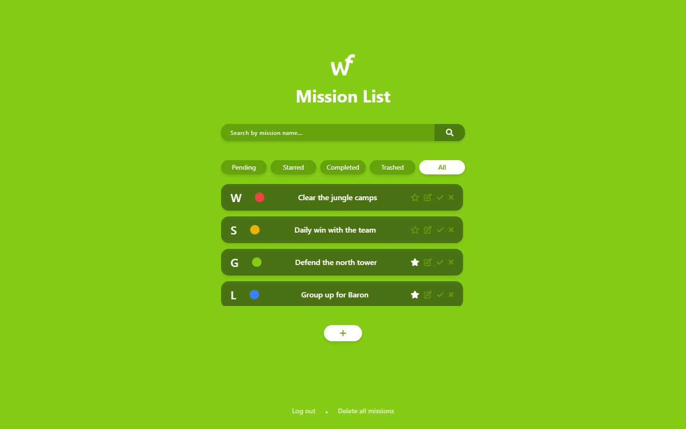
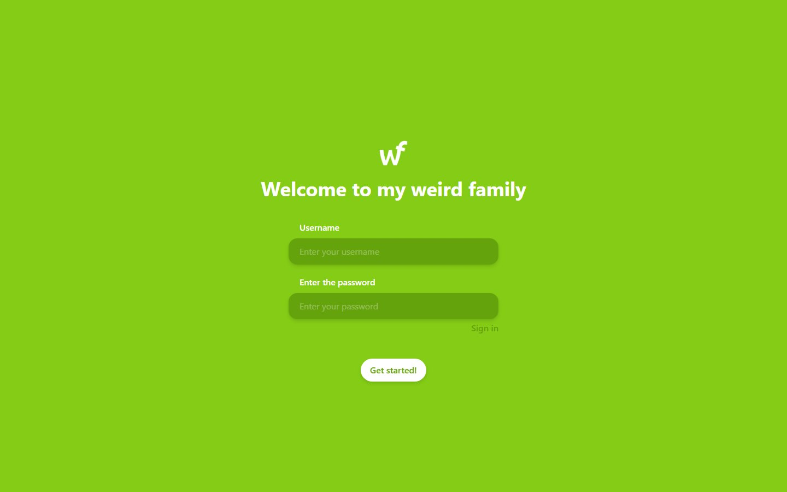
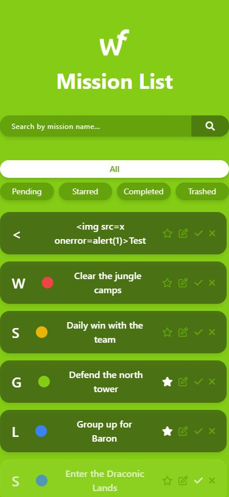

# Mission List

> A to-do list where every task is a "mission" assigned to a League of Legends champion. Built in 2022 as a PHP learning project (no framework: a small MVC written from scratch), tidied up in 2026.

[](https://github.com/wavesforweirdos/mission-list/actions/workflows/ci.yml)



## Features

- Register and log in; each user has their own list, stored in a JSON file (no database needed)
- Create, edit, complete, star and delete missions. Each one has a title, an assigned champion, a tag (Defense, Group, Daily or Attack) and a finish date
- Filter by status (all, pending, starred, completed, trashed) and search by name
- Delete every mission at once
- Responsive layout with Tailwind

| Log in | On a phone |
|---|---|
|  |  |

## How it works

The `web/index.php` front controller sends every request through a tiny router (`config/routes.php`) to a controller in `app/controllers`, which uses the models in `app/models` and renders a view from `app/views`.

```
app/controllers/   user, mission, error and test controllers
app/models/        User and Mission: they read and write the JSON files
app/views/         layout and the .phtml views
config/            routes and the data folder (config/database/)
lib/base/          router, controller, view and request base classes, and the e() escape helper
web/               the public folder (index.php, assets)
tests/smoke.sh     smoke test run in CI
```

## Getting started

You only need PHP 8.0+.

```sh
git clone https://github.com/wavesforweirdos/mission-list
cd mission-list
php -S localhost:8000 -t web web/index.php
```

Open http://localhost:8000 and log in with the demo user **`demo`** / **`demo1234`** (it comes with a few missions), or create your own account. Errors are hidden by default; start the server with `APP_DEBUG=1` to see them.

Users and missions live in `config/database/` (`users.json` and `<user>-missions.json`). The demo files are tracked in git, so running the app will modify them: use `git checkout config/database` to reset them.

### Tests

```sh
tests/smoke.sh
```

It starts the server and checks the login, that the private pages need a session and that dangerous usernames are rejected. The same script runs in GitHub Actions, together with a PHP lint.

## Security notes

- Usernames are limited to letters, numbers, `_` and `-` because they are part of the data file name
- Everything a user writes is escaped when it is printed (`e()` helper)
- Registering does not log you in, and the mission pages need a logged-in session
- It is a learning project: there is no CSRF protection, and Tailwind and Font Awesome come from a CDN, so don't use it as-is on the public internet

## Other storage backends

The same app, with MySQL and with MongoDB instead of JSON files, lives in the `release-mysql/0.1.0` and `release-mongodb/0.1.0` branches. This branch is the JSON version.

## Deployment

It needs a PHP host, so it can't run on static hosting like GitHub Pages.
